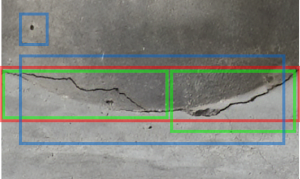

# Multi-Annotator Toolkit

> [!NOTE]
> **v0.6.0 is a clean-slate rewrite** combining a lightweight annotator UI, an auto-labeling review loop (accept / edit / reject), and [KαLOS](https://github.com/Madave94/kalos) (CVPR 2026) inter-annotator agreement analysis on top of [FiftyOne](https://github.com/voxel51/fiftyone).

<p align="center">
  
</p>

## Legacy Version (WACV 2025 Paper — `v0.5.5`)

The original plugin accompanying *"Label Convergence: Defining an Upper Performance Bound in Object Recognition through Contradictory Annotations"* (WACV 2025) — including mmAP convergence analysis, K-Alpha (`kalphacv`), and variation/error analysis — is archived at tag [`v0.5.5`](https://github.com/Madave94/multi-annotator-toolkit/tree/v0.5.5):

```bash
fiftyone plugins download Madave94/multi-annotator-toolkit/v0.5.5
```

## Status

Under active rewrite (`0.6.0`). See `src/multi_annotator_toolkit/` for the core package and `plugins/multi_annotator_toolkit/` for the FiftyOne plugin.

## References

- **KαLOS (CVPR 2026):** Tschirschwitz, D. & Rodehorst, V. *"KαLOS finds Consensus: A Meta-Algorithm for Evaluating Inter-Annotator Agreement in Complex Vision Tasks"*, CVPR 2026. ([arXiv:2603.27197](https://arxiv.org/abs/2603.27197))
- **Label Convergence (WACV 2025):** Tschirschwitz, D. & Rodehorst, V. *"Label Convergence: Defining an Upper Performance Bound in Object Recognition through Contradictory Annotations"*, WACV 2025. ([arXiv:2409.09412](https://arxiv.org/abs/2409.09412))
